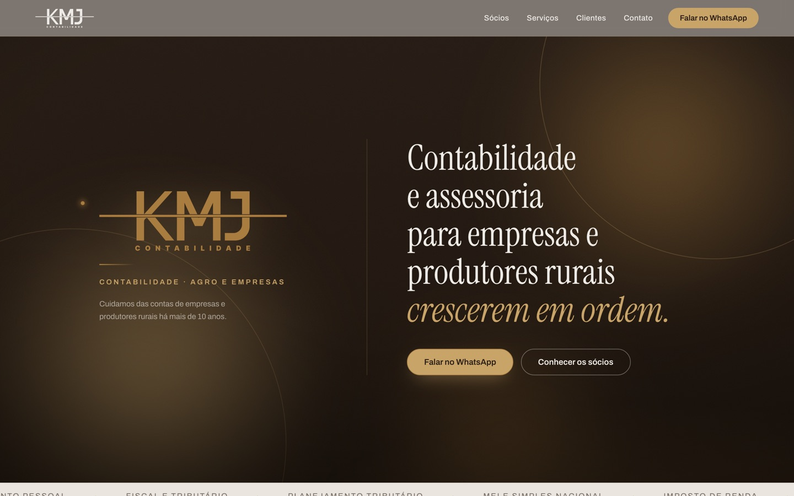
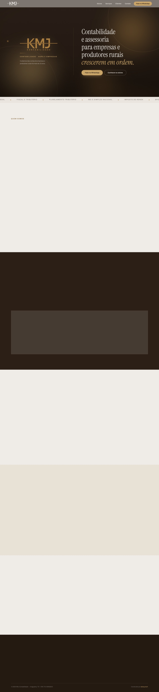

<h1 align="center">KMJ Contabilidade</h1>

Site institucional de um escritório de contabilidade de Araguaína (TO) que atende empresas e produtores rurais.

## Sobre

Página única com os sócios, os serviços (abertura de empresa, planejamento tributário, departamento pessoal e BPO financeiro), números do escritório, depoimentos e o Instagram. Os botões levam ao WhatsApp da KMJ. Fiz o projeto para o cliente pela [Abisay Tech](https://abisay.tech).

## Telas

| Desktop (página completa) | Mobile |
|:-:|:-:|
|  |  |

## Como foi feito

- Para a busca local, o site publica JSON-LD do tipo `AccountingService` com o endereço e uma oferta para cada serviço. A imagem de Open Graph é gerada no build, e há sitemap e robots.
- O dourado da marca tem contraste de 3,1:1 em texto pequeno. Criei um tom mais escuro, com 4,7:1 ou mais (WCAG AA), para os textos e deixei o dourado original nos elementos grandes.
- O GSAP anima o scroll e o Framer Motion, as entradas. Os dois param quando o sistema pede `prefers-reduced-motion`, e o conteúdo aparece mesmo com o JavaScript desligado.
- A CSP só permite `unsafe-eval` em desenvolvimento. O site também envia `X-Frame-Options` e `Permissions-Policy`.
- As fontes saem do próprio domínio via `next/font`, as imagens são servidas em AVIF ou WebP e as páginas são geradas de forma estática na Vercel, com o Speed Insights medindo o desempenho.

## Stack

Next.js 14 (App Router) · React 18 · TypeScript · GSAP + ScrollTrigger · Framer Motion · CSS com tokens · Vercel Analytics e Speed Insights

Projeto de cliente com código-fonte privado. Para conversar sobre um projeto parecido, fale comigo em <a href="https://abisay.tech">abisay.tech</a> ou no <a href="https://www.linkedin.com/in/jahncarlos">LinkedIn</a>.
